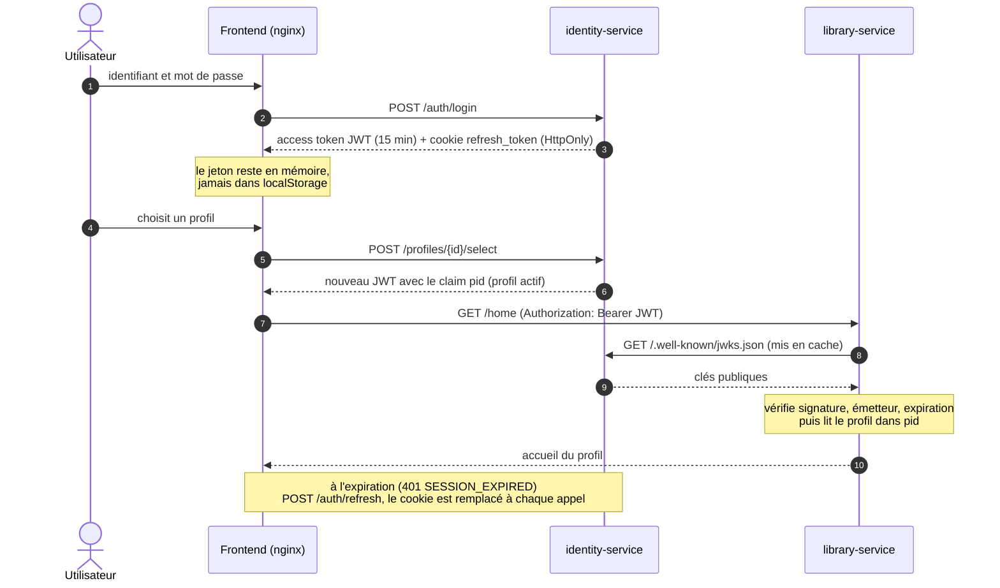
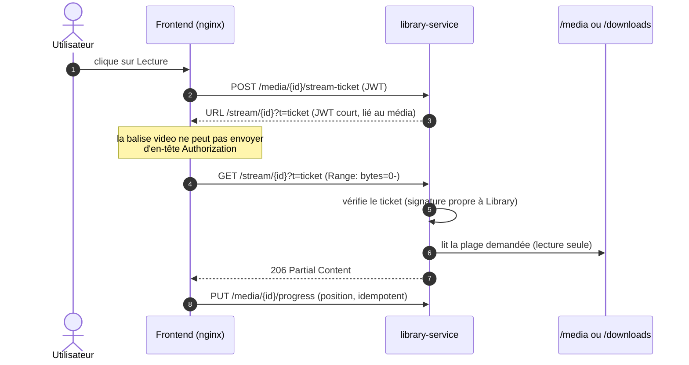
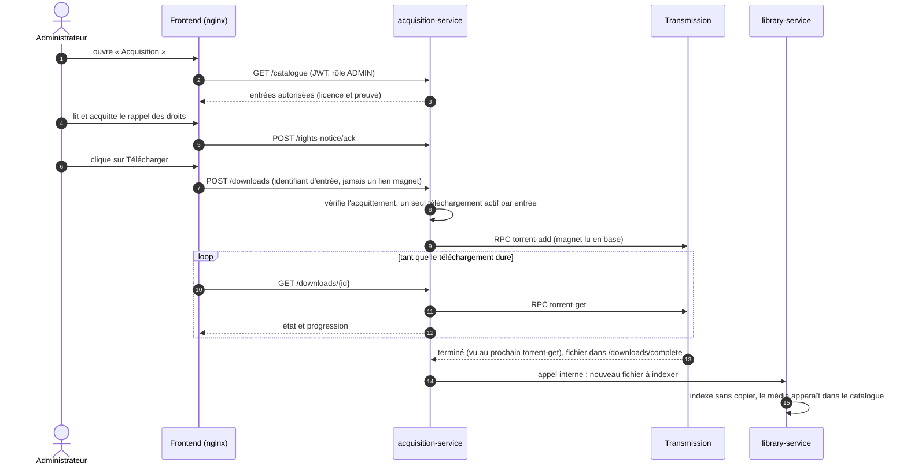

# Architecture technique de HomeFlix

HomeFlix est une plateforme de streaming personnelle, auto-hébergée : trois services Spring Boot (Identity, Library, Acquisition), une base PostgreSQL, un frontend React servi par nginx, et un client BitTorrent (Transmission) isolé. Tout démarre avec `docker compose up`.

Ce document donne la vue d'ensemble. Le détail est dans les ADR (`docs/adr/`), le modèle de données (`docs/architecture/data-model.md`) et les contrats d'API (`docs/api/`).

## Comment lire l'état d'avancement

Le contrat d'API (OpenAPI) est écrit avant le code. Les tableaux et diagrammes de ce document décrivent l'architecture **cible**, et la colonne « État » dit ce qui est réellement fusionné sur `main`.

| État | Sens |
|---|---|
| fait | codé, testé, fusionné sur `main` |
| contrat seul | décrit dans l'OpenAPI, pas encore codé |

État relevé le 18/11/2026 (J3). Les éléments « contrat seul » sont suivis par des issues du projet ; ce document est à relire avant la soutenance.

## 1. Vue d'ensemble

```mermaid
flowchart LR
    user["Utilisateur<br/>(navigateur)"]
    admin["Administrateur<br/>(navigateur)"]
    subgraph host["Machine hôte (Docker Compose)"]
        nginx["frontend<br/>nginx + application React<br/>seul port publié : 8080"]
        subgraph internal["réseau interne"]
            identity["identity-service<br/>8081"]
            library["library-service<br/>8082"]
            acquisition["acquisition-service<br/>8083"]
            db[("PostgreSQL 17<br/>3 bases, 3 rôles")]
        end
        subgraph torrent["réseau torrent"]
            transmission["Transmission<br/>RPC 9091"]
        end
        media["/media (lecture seule)<br/>bibliothèque de l'utilisateur"]
        downloads["/downloads<br/>fichiers téléchargés"]
    end
    internet(("Internet<br/>trackers et pairs"))

    user -->|HTTP 8080| nginx
    admin -->|HTTP 8080| nginx
    nginx -->|"/api/identity/"| identity
    nginx -->|"/api/library/"| library
    nginx -->|"/api/acquisition/"| acquisition
    identity --> db
    library --> db
    acquisition --> db
    library -.->|JWKS| identity
    acquisition -.->|JWKS| identity
    acquisition -->|RPC| transmission
    acquisition -.->|appel interne| library
    transmission -->|sortant uniquement| internet
    library --> media
    library --> downloads
    transmission --> downloads
    acquisition --> downloads
```

Lecture du schéma :
- **Un seul point d'entrée** : nginx (port 8080). Il sert l'application et redirige `/api/identity/`, `/api/library/` et `/api/acquisition/` vers le bon service. Aucun autre port n'est publié.
- **Une base par service** : même serveur PostgreSQL, trois bases et trois rôles. La base empêche un service de se connecter à celle d'un autre.
- **Transmission isolé** : il n'est que sur le réseau `torrent`, avec Acquisition. Library, Identity, le frontend et la base ne peuvent ni le joindre ni résoudre son nom.
- **Traits pointillés** : appels entre services (clés publiques d'Identity, appels internes d'Acquisition vers Library).

## 2. Les services

| Service | Responsabilité | Données | État |
|---|---|---|---|
| **identity-service** (8081) | Comptes, rôles, profils, connexion, jetons, premier administrateur | base `identity` | `/setup`, JWKS : fait. Connexion, refresh, profils, comptes : contrat seul |
| **library-service** (8082) | Dossiers autorisés, indexation des vidéos, catalogue, flux avec Range, progression, favoris, accueil | base `library` ; lit `/media` et `/downloads` en lecture seule | dossiers autorisés et indexation : fait. Catalogue, flux, progression, favoris, accueil : contrat seul |
| **acquisition-service** (8083) | Catalogue autorisé, rappel des droits, téléchargements pilotés sur Transmission | base `acquisition` ; écrit dans `/downloads` | liste du catalogue : faite. Droits, téléchargements, adaptateur Transmission : contrat seul |
| **frontend** | Interface (React, Vite) et reverse proxy (nginx) | aucune | pages d'authentification, de profils et de première configuration, carte film : faites ou en relecture ; accueil, fiche et lecteur : emplacements vides |
| **transmission** | Télécharge les fichiers BitTorrent | `transmission-config` ; écrit dans `/downloads` | fait (configuration, isolation, réglages) |
| **db** | PostgreSQL 17 | volume `pgdata` | fait (3 bases, 3 rôles) |

Contrats complets : [`identity.openapi.yaml`](api/identity.openapi.yaml), [`library.openapi.yaml`](api/library.openapi.yaml), [`acquisition.openapi.yaml`](api/acquisition.openapi.yaml). Conventions d'erreur : [`CONVENTIONS.md`](api/CONVENTIONS.md).

### Principales routes par service

| Service | Routes (préfixe `/api/v1`, vu du service) | État |
|---|---|---|
| Identity | `GET /setup/status`, `POST /setup` | fait |
| Identity | `POST /auth/login`, `/auth/refresh`, `/auth/logout`, `GET /auth/me` | contrat seul |
| Identity | `GET/POST /profiles`, `PATCH/DELETE /profiles/{id}`, `POST /profiles/{id}/select` | contrat seul |
| Identity | `/admin/accounts…`, `DELETE /accounts/me` | contrat seul |
| Identity | `GET /.well-known/jwks.json` (réseau interne) | fait |
| Library | `/admin/media-roots…` (dossiers autorisés), `POST /admin/index`, `GET /admin/index/status` | fait |
| Library | `GET /media`, `GET /media/{id}`, `GET /genres`, `GET /home` | contrat seul |
| Library | `POST /media/{id}/stream-ticket`, `GET /stream/{id}` | contrat seul |
| Library | `/media/{id}/progress`, `/me/favourites…`, `/me/continue-watching` | contrat seul |
| Acquisition | `GET /catalogue` | fait |
| Acquisition | `GET /rights-notice`, `POST /rights-notice/ack` | contrat seul |
| Acquisition | `POST/GET /downloads`, `GET /downloads/{id}`, `POST /downloads/{id}/cancel` | contrat seul |

Vu du navigateur, une route s'écrit avec le préfixe du service : `/api/library/v1/media`. Le proxy retire le nom du service avant de transmettre (`/api/library/v1/media` devient `library-service:8082/api/v1/media`).

## 3. Propriété des données

Chaque service possède sa base et ses migrations Flyway. **Aucun service ne lit ni n'écrit dans la base d'un autre**, et aucune clé étrangère ne traverse une frontière de service : les identifiants de compte et de profil sont stockés « à plat » dans Library et Acquisition.

| Service | Base | Propriétaire de |
|---|---|---|
| identity-service | `identity` | comptes, rôles, profils, sessions (refresh tokens), état du setup |
| library-service | `library` | dossiers autorisés, médias, métadonnées, favoris, progression |
| acquisition-service | `acquisition` | catalogue autorisé, téléchargements, acquittements du rappel des droits |

Les schémas, les contraintes et la façon dont la base garantit les règles (droits non vides, un seul téléchargement actif par entrée) sont dans [`data-model.md`](architecture/data-model.md).

Quand une donnée d'un service concerne un autre (suppression d'un profil, fin d'un téléchargement), le service concerné est prévenu par un **appel interne** et non par un accès à sa base. Supprimer un compte, un profil ou une entrée du catalogue ne supprime jamais un fichier média.

## 4. Séquences

### 4.1 Connexion et profil actif

État : la validation du jeton par Library et Acquisition (JWKS, 3 s de délai) est **faite** ; la connexion, le refresh, les profils et l'accueil sont en **contrat seul**. Si Identity est injoignable pendant la vérification d'un jeton, le comportement voulu par l'ADR 0001 est un **503 `IDENTITY_UNAVAILABLE`** et non un 401 qui ferait croire à une session expirée : correction en relecture (PR #189), à jour dans ce document après sa fusion.

Décisions détaillées : [ADR 0001](adr/0001-auth-and-service-security.md).

### 4.2 Lecture d'une vidéo

État : contrat seul. Le ticket de streaming remplace le jeton de session dans l'URL : il est court, lié à un média et signé par une clé que seule Library connaît. Le proxy ne met pas en mémoire tampon les réponses de Library, pour laisser passer le streaming et les requêtes `Range`.

### 4.3 Acquisition d'un contenu autorisé

État : le catalogue est **fait** ; les droits, les téléchargements, l'adaptateur Transmission et l'appel interne vers Library sont en **contrat seul**. La partie Transmission (réseau isolé, réglages, arrêt du partage à la fin) est **faite** et prouvée sur un vrai téléchargement (voir [`docs/legal/P2P_DEMO.md`](legal/P2P_DEMO.md)).

Garde-fous : Acquisition n'accepte que des identifiants d'entrées du catalogue autorisé, jamais une URL ni un lien magnet fournis par l'utilisateur ; une entrée sans licence ni preuve ne peut pas exister en base.

## 5. Sécurité en bref

| Sujet | Choix | Où |
|---|---|---|
| Jetons de connexion | JWT RS256 de 15 min ; Library et Acquisition vérifient la signature avec les clés publiques d'Identity (JWKS), sans l'appeler à chaque requête | ADR 0001 |
| Session | refresh token opaque, rotatif, en cookie HttpOnly `SameSite=Strict` ; access token en mémoire | ADR 0001 |
| Profil actif | lu dans le jeton (`pid`), jamais dans l'URL ni le corps | ADR 0001 |
| Flux vidéo | ticket court lié au média, signé par Library | ADR 0001 |
| Routes internes | `/internal` et `/actuator` ne sont jamais routés par le proxy (404) ; secret partagé `X-Internal-Key` entre services | ADR 0001, ADR 0002 |
| Rôle administrateur | Acquisition : `/api/v1/**` réservé à ADMIN, vérifié deux fois (règle d'URL et annotation `@PreAuthorize`). Library : `/api/v1/admin/**` réservé à ADMIN (règle d'URL) | code |
| Navigateur | CSP stricte, `frame-ancestors 'none'`, `Permissions-Policy`, pas de version nginx | ADR 0002 §11 |
| Mots de passe | Argon2id, 12 caractères minimum | ADR 0001 |
| Secrets | aucun dans le dépôt ; `.env` ignoré, généré par `scripts/gen-secrets.sh` | ADR 0002 §9 |
| Erreurs | `application/problem+json` avec un `code` stable ; jamais de détail technique | `CONVENTIONS.md` |

## 6. Réseau, ports et volumes

### Ports

| Composant | Port du conteneur | Publié sur l'hôte |
|---|---|---|
| frontend (nginx) | 8080 | oui, `${FRONTEND_PORT:-8080}` : le seul |
| identity-service | 8081 | non |
| library-service | 8082 | non |
| acquisition-service | 8083 | non |
| PostgreSQL | 5432 | non |
| Transmission (RPC) | 9091 | non |
| Transmission (pairs) | 51413 | non (trafic sortant seulement) |

### Réseaux

| Réseau | Membres | Rôle |
|---|---|---|
| `internal` | db, identity, library, acquisition, frontend | communication entre services |
| `torrent` | acquisition, transmission | seul chemin vers Transmission |

### Volumes

| Chemin dans les conteneurs | Source | Library | Acquisition | Transmission |
|---|---|---|---|---|
| `/media` | dossier de l'hôte `MEDIA_DIR` (défaut `./demo-media`) | lecture seule | non monté | non monté |
| `/downloads` | volume `downloads` ou dossier de l'hôte `DOWNLOADS_DIR` | lecture seule | lecture et écriture | lecture et écriture |
| `/config` | volume `transmission-config` | non | non | oui |
| données PostgreSQL | volume `pgdata` | non | non | non |

Les fichiers terminés arrivent dans `/downloads/complete` : c'est ce dossier qu'il faut déclarer comme dossier autorisé dans Library. Les partiels (`/downloads/incomplete`) n'apparaissent jamais dans le catalogue.

### Variables d'environnement

Le fichier `.env` est généré par `./scripts/gen-secrets.sh` à partir de `.env.example` (aucune valeur par défaut n'est utilisable comme secret).

| Variable | Utilisée par | Rôle | Secret |
|---|---|---|---|
| `POSTGRES_PASSWORD` | db | administrateur PostgreSQL, seulement à la création des bases | oui |
| `IDENTITY_DB_PASSWORD`, `LIBRARY_DB_PASSWORD`, `ACQUISITION_DB_PASSWORD` | db et le service concerné | un rôle SQL par service | oui |
| `INTERNAL_API_KEY` | les trois services | appels internes (`X-Internal-Key`) | oui |
| `JWT_PRIVATE_KEY_BASE64` | identity | clé privée de signature des jetons | oui |
| `STREAM_TICKET_SECRET` | library | signature des tickets de streaming | oui |
| `SETUP_TOKEN` | identity | création du premier administrateur (usage unique) | oui |
| `TRANSMISSION_USER`, `TRANSMISSION_PASS` | acquisition, transmission | identifiants du RPC | mot de passe : oui |
| `TRANSMISSION_DHT`, `TRANSMISSION_PEX`, `TRANSMISSION_LIMIT_UP`, `TRANSMISSION_LIMIT_DOWN` | transmission | réglages P2P (DHT et PEX désactivés par défaut) | non |
| `MEDIA_DIR`, `DOWNLOADS_DIR` | library, acquisition, transmission | dossiers de l'hôte montés | non |
| `PUID`, `PGID` | acquisition, transmission | UID/GID qui écrivent dans `/downloads` | non |
| `FRONTEND_PORT` | frontend | port publié sur l'hôte | non |

Variables internes fixées par `compose.yaml` (pas dans `.env`) : `SERVER_PORT`, `DB_URL`, `DB_USER`, `IDENTITY_JWKS_URI`, `LIBRARY_BASE_URL`, `TRANSMISSION_URL`, `MEDIA_ROOT`, `DOWNLOADS_ROOT`.

## 7. Exploitation

| Script | Rôle |
|---|---|
| `homeflix/scripts/gen-secrets.sh` | génère `.env` |
| `homeflix/scripts/smoke.sh` | test de fumée de la pile complète (lancé par la CI) |
| `homeflix/scripts/check-security-headers.sh` | vérifie les en-têtes du proxy |
| `homeflix/scripts/backup.sh`, `restore.sh` | sauvegarde et restauration des bases (`pg_dump`) ; jamais de `.env` dans l'archive |
| `homeflix/scripts/test-backup-restore.sh` | prouve qu'une sauvegarde se restaure |
| `homeflix/scripts/test-persistence.sh` | prouve que les données survivent à `docker compose restart` et à `down` puis `up` (lancé par la CI, dans l'étape du test de fumée) ; `--simulate-loss` prouve que le test détecte une perte |

Intégration continue : GitHub Actions, 12 vérifications (tests des trois services, frontend, contrats OpenAPI, Docker Compose, images, scan de secrets, test de fumée et de persistance).

## 8. Choix technologiques

| Choix | Pourquoi | Alternative écartée |
|---|---|---|
| Spring Boot 4.1, Java 21, trois services | imposé par le sujet ; une responsabilité par service, des données séparées | un monolithe |
| PostgreSQL 17, une base et un rôle par service | la règle « aucun accès croisé » est appliquée par la base | un schéma partagé ; un serveur par service |
| Flyway et `ddl-auto=validate` | schéma versionné, jamais modifié en silence | génération automatique du schéma |
| nginx dans l'image frontend | sert l'application et fait office de reverse proxy sans composant de plus | gateway Spring Cloud, Traefik |
| JWT RS256 et JWKS | les services vérifient sans appeler Identity et sans pouvoir forger de jeton | HS256 partagé, introspection à chaque requête |
| Ticket de streaming | la balise `video` n'envoie pas d'en-tête ; un ticket court évite d'exposer le jeton de session | jeton de session dans l'URL |
| Transmission piloté en RPC, réseau isolé | RPC simple à intégrer ; surface d'attaque limitée | qBittorrent, moteur maison |
| React et Vite | écosystème et tests rapides (Vitest) | — |
| Docker Compose | démarrage reproductible en une commande | installation manuelle |
| Testcontainers | tests d'intégration contre un vrai PostgreSQL | base en mémoire (comportement différent) |

Justifications complètes et alternatives : [ADR 0001](adr/0001-auth-and-service-security.md) (identité et sécurité) et [ADR 0002](adr/0002-infrastructure.md) (infrastructure).

## 9. Limites connues

- Le rôle d'un jeton est celui de son émission : une désactivation de compte prend effet au prochain refresh (15 min au plus).
- `.env` ignoré par Git suffit pour le MVP ; les secrets Docker (`secrets:`) seraient mieux isolés.
- La rotation de la clé de signature des jetons n'est pas prévue (le JWKS ne publie qu'une clé).
- Le port de pairs BitTorrent n'est pas publié : les téléchargements fonctionnent en trafic sortant seul, parfois plus lentement.
- Environnements testés : Docker Engine sur Linux et Docker Desktop (Windows, WSL2). NAS et partages SMB/NFS : sans garantie.
- Connexion en HTTP hors `localhost` : un cookie `Secure` n'est pas conservé par le navigateur ; utiliser HTTPS (ADR 0002 §11).
