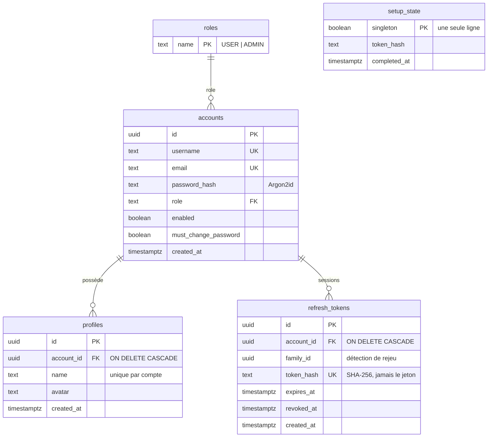
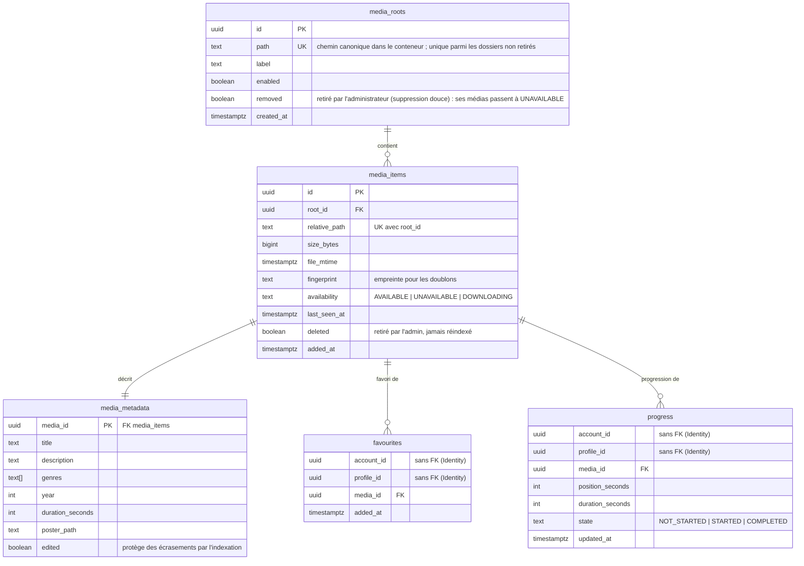
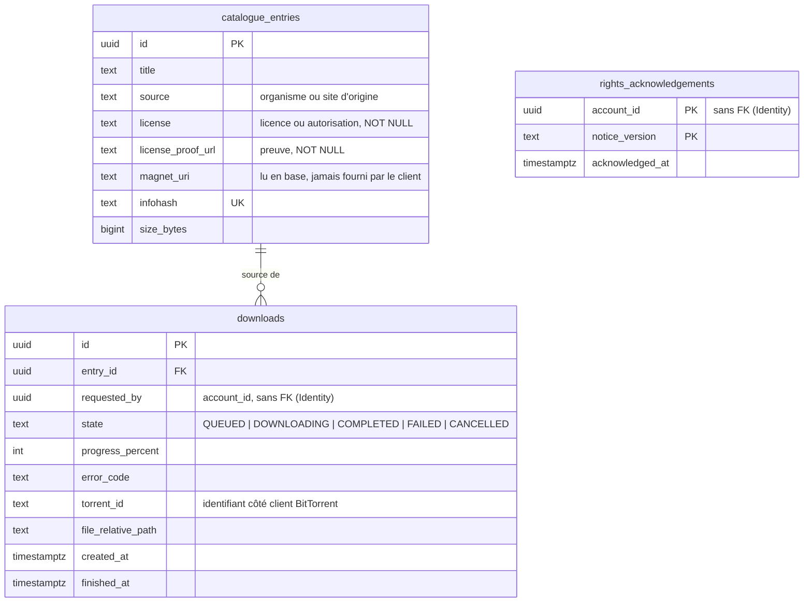

# Modèle de données et propriété des données

Chaque service possède sa base PostgreSQL (rôle SQL dédié, voir `homeflix/initdb/`) et ses migrations Flyway. **Aucun service ne lit ni n'écrit dans la base d'un autre**, et aucune clé étrangère ne traverse une frontière de service : les références entre services (`account_id`, `profile_id`, `media_id`) sont de simples UUID, sans contrainte.

| Service | Base | Propriétaire de |
|---|---|---|
| identity-service | `identity` | comptes, rôles, profils, sessions (refresh tokens), état du setup |
| library-service | `library` | dossiers autorisés, médias, métadonnées, favoris, progression |
| acquisition-service | `acquisition` | catalogue autorisé, téléchargements, acquittements du rappel des droits |

## Identity

Règles : 5 profils maximum par compte (appliqué par le service) ; le dernier administrateur ne peut être ni désactivé, ni rétrogradé, ni supprimé ; le jeton de setup n'est plus valide dès que `completed_at` est renseigné.

## Library

Contraintes : `UNIQUE (root_id, relative_path)` et empreinte de contenu pour éviter les doublons entre scans ; `UNIQUE (profile_id, media_id)` sur `favourites` et `progress`. Les lignes `favourites` et `progress` conservent `account_id` pour permettre la purge d'un compte entier.

## Acquisition

Règles : une entrée sans licence ni preuve ne peut pas être insérée (contraintes `NOT NULL`) ; un seul téléchargement actif par entrée ; l'acquittement du rappel des droits est requis avant le premier téléchargement d'un compte.

## Cohérence entre services

| Événement | Service source | Effet dans les autres services | Mécanisme |
|---|---|---|---|
| Suppression d'un profil | Identity | Library supprime ses favoris et sa progression | `POST /internal/purge` (profil) |
| Suppression d'un compte | Identity | Library purge toutes les données du compte ; Acquisition supprime ses acquittements | `POST /internal/purge` (compte) |
| Téléchargement démarré | Acquisition | Library peut afficher l'entrée en `DOWNLOADING` | `POST /internal/...` de Library |
| Téléchargement terminé | Acquisition | Library enregistre le fichier du dossier de téléchargements et lance l'indexation | `POST /internal/...` de Library |

- La purge est **asynchrone et rejouable** : si l'appel échoue, Identity conserve une demande de purge en attente et réessaie. Une donnée orpheline (profil supprimé) est inoffensive car Library n'expose une ligne que via le `pid` d'un jeton valide.
- Library traite un `account_id` ou `profile_id` inconnu comme une donnée sans propriétaire ; elle ne les valide jamais en interrogeant la base d'Identity.
- Supprimer un compte, un profil ou une entrée du catalogue **ne supprime jamais un fichier média**.
